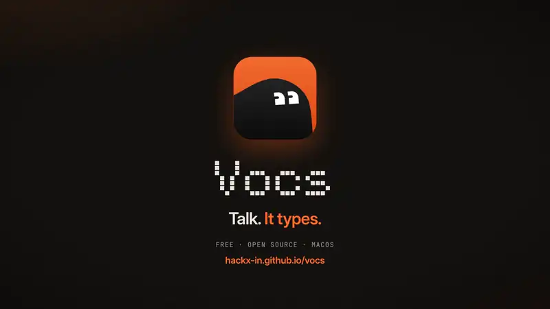

# Vocs

Press a key, talk, press it again — your words are on the clipboard and pasted
before you can look up.

Local-first speech to text for macOS. No account, no subscription, no word cap,
and no audio ever leaves your machine.

**[Download](https://hackx-in.github.io/vocs/)** · [Releases](https://github.com/HackX-IN/vocs/releases) · [Changelog](CHANGELOG.md) · [♥ Sponsor](https://github.com/sponsors/HackX-IN)

<a href="https://github.com/HackX-IN/vocs/blob/main/brag-output/brag.mp4">
  
</a>

<p align="center">
  <a href="https://github.com/HackX-IN/vocs/blob/main/brag-output/brag.mp4"><b>▶ Watch the launch video</b></a>
  &nbsp;·&nbsp;
  <a href="https://github.com/sponsors/HackX-IN"></a>
</p>

---

## What it does

- **Global hotkey** — ⌥Space anywhere. Toggle, or hold-to-talk.
- **Transcribes while you speak**, not after you stop, so finishing is as fast
  after a five-minute monologue as after a five-second one.
- **Pastes into whatever had focus**, and puts your clipboard back afterwards.
- **Escape to cancel**, with a three-second countdown. Press Escape again and
  the recording resumes with nothing lost.
- **99 languages**, auto-detected or pinned.
- **A custom dictionary** for the names and jargon the model gets wrong — used
  both to bias recognition and to correct the output.
- **A notebook of everything you dictated** — **Dictations** — searchable and filterable by period and status. Open one to edit it like a notepad: find in it, rename it, and it saves itself. It is local history, so a failed paste is never a lost thought. Where
  the rules changed your words, History shows what you said against what was
  delivered, and **Use original** takes your wording instead. **Copy Last
  Transcript** in the menu bar, or an optional global shortcut (off until you
  turn it on), is the way back from a paste that went nowhere.
- **Writing style** — natural, casual, formal or literal, set once for everywhere.
- **Preview before pasting** and **live captions** (both off by default): see the finished text for a moment before it lands, or watch what Vocs hears rise out of the recording pill as you speak.
- **Filler removal that does not eat real words**, at three strengths. "I like
  pizza" is never touched; "it was, like, fine" loses the "like".
- **Optional grammar fixes** for slips that are wrong every time — "a idea",
  "she don't", "we was", "could of been" — with the rest of your sentence left
  exactly as you said it. Off by default; quoted speech and your dictionary are
  never touched. That rule set is small on purpose: it fixes less, and it
  cannot make a mistake you would not have spotted.
- **Smart grammar, on your Mac.** Turn on an optional on-device model (a ~120 MB
  download, then offline) for the agreement and tense slips rules cannot see.
  It never rewrites you: only safe word-level fixes are kept, and names,
  numbers, code and your dictionary are off limits. It also learns: a fix you
  keep three times and never undo starts applying itself, and you can see,
  switch off or delete everything it has learned.
- **A context line for the model** — jargon, product names, the topic — that it
  listens for ahead of your dictionary.
- **A live microphone meter** in Settings → Recording, on the device dictation
  will actually use.
- **Back up and restore** your dictionary as one JSON file,
  to move them between Macs. Importing adds; it never deletes.
- **Crash-safe**: the transcript is saved as it grows, so a crash keeps what you
  had said.
- **Honest stats**, including the p50/p95 latency the app actually achieves, per
  stage: capture, recognition, correction, output.
- **Export diagnostics** — a plain-text support file you create and send
  yourself. There is no telemetry.

Everything runs on your Mac. The only network requests Vocs ever makes are the
first-run model download and an optional update check, and both are visible and
both can be turned off.

## Requirements

- macOS 13 or later, Apple Silicon or Intel
- ~600 MB of disk for the default model

## Running it

```bash
pnpm install
pnpm tauri dev
```

First launch opens setup: grant the microphone, download the model, and test the
hotkey. After that Vocs lives in the menu bar. Opening the app (from Finder,
Launchpad or Spotlight) shows the dashboard; when it starts by itself at login
it stays quietly in the menu bar.

## Building a release

```bash
pnpm tauri build
```

The bundle lands in `src-tauri/target/release/bundle/` — a `.app`, a `.dmg`,
and an updater archive.

**Signing the updater archive.** Because a public key is configured, Tauri also
signs the update artifact, and it needs the matching private key:

```bash
TAURI_SIGNING_PRIVATE_KEY="$(cat ~/.vocs-updater.key)" \
TAURI_SIGNING_PRIVATE_KEY_PASSWORD="" \
  pnpm tauri build
```

Both variables are required. Setting the key without the password makes Tauri
prompt for one interactively, which fails in any non-interactive shell with a
misleading "incorrect password" error — the password is empty, it simply had no
way to tell you so.

Without either, the `.app` and `.dmg` still build correctly and only the update
artifact goes unsigned. In CI both come from repository secrets.

> **Back that private key up somewhere you will still have in five years.**
> It is the only thing that can sign an update. If it is lost, every existing
> installation is permanently stranded on whatever version it has — there is no
> recovery, because the public key is compiled into the apps already out there.

### Distributing without an Apple Developer account

Vocs is distributed as a DMG from our own website, not the App Store, and
without Apple notarisation. That works, with two consequences you must plan for.

**What a user sees on the first launch.** Gatekeeper blocks the DMG itself
("Vocs-macOS.dmg" Not Opened: "Apple could not verify…"), and may block the app
again once it is copied out. The user chooses **Done** (not Move to Trash), then
opens **System Settings → Privacy & Security**, scrolls to the message and
chooses **Open Anyway** (or runs `xattr -dr com.apple.quarantine` on the DMG,
and on `/Applications/Vocs.app` if asked). This happens once per file.
In-app updates are downloaded by the app itself, so they do not trigger it
again. The download page on the website must show these steps.

**Sign every release with the same self-signed certificate, forever.** An
ad-hoc signature is new on every build, so each update would silently reset the
user's Accessibility grant and pasting would stop working. A stable certificate
keeps the grant. Create it once:

1. Keychain Access → Certificate Assistant → *Create a Certificate…* — name it
   `Vocs Signing`, identity type *Self Signed Root*, type *Code Signing*.
2. Export it with its private key as a `.p12` and keep it in a password manager.
   **Losing or replacing it voids every user's Accessibility grant.**
3. Add three repository secrets: `APPLE_CERTIFICATE` (`base64 -i vocs.p12`),
   `APPLE_CERTIFICATE_PASSWORD`, and `APPLE_SIGNING_IDENTITY` (`Vocs Signing`).
   Leave `APPLE_ID`, `APPLE_PASSWORD` and `APPLE_TEAM_ID` unset; the release
   workflow then signs without notarising.

The updater needs its own, separate keypair (`pnpm tauri signer generate`); its
private half goes in `TAURI_SIGNING_PRIVATE_KEY`.

If an Apple Developer account is added later, the only change is the secrets: a
Developer ID certificate in `APPLE_CERTIFICATE` and the three Apple variables.
Existing users then need to re-grant Accessibility once, because the signing
identity changes.

## Permissions, and what happens without them

| Permission | Needed for | Without it |
|---|---|---|
| Microphone | Recording | Vocs cannot record. Required. |
| Accessibility | Pasting for you | Everything still works — text goes to the clipboard instead. |

macOS shows each of these prompts **once per app**. If you dismiss one, the
dialog never comes back, so Vocs takes you straight to the right System
Settings pane instead of asking again.

### If Accessibility keeps forgetting you granted it

macOS keys permission grants to the bundle id **plus the code signature**.
Builds here are ad-hoc signed, which produces a new signature every time, so
**every rebuild looks like a different app** and the Accessibility grant is
lost. Pasting silently degrades to clipboard-only and nothing explains why.

That is a development annoyance, not a bug, and it does not affect a released
build. If you are rebuilding often, create one self-signed code-signing
certificate in Keychain Access and sign every build with that same identity —
the signature then stays stable and macOS stops forgetting. `docs/03 §3.4` has
the detail.

## For developers

The architecture is documented in `docs/`, and `CLAUDE.md` is the rulebook.
Start with `docs/00-START-HERE.md`; read `docs/06-CONVENTIONS-AND-GREP.md`
before writing your first file, because navigation here works through a
comment-based search index rather than by reading the tree:

```bash
pnpm sot SessionState      # which files own this symbol
pnpm sot:show AudioChunk   # the same, with each file's header
```

Two ideas carry the codebase. **The registry** (`src-tauri/src/registry/`) is one
table describing every feature — adding an entry wires up its settings UI,
permission preflight, nav placement, hotkey and metrics at once. **The command
factory** (`src-tauri/src/ipc/factory.rs`) is the single function every IPC call
passes through, so validation, permissions, reentrancy, tracing and error
mapping have one implementation instead of one per handler.

Types cross to TypeScript through `tauri-specta`: `src/lib/bindings.ts` is
generated by `cargo test` and must never be hand-edited.

```bash
cargo test --manifest-path src-tauri/Cargo.toml   # also regenerates bindings
pnpm typecheck
```

## Contributing

Issues and pull requests are welcome. Read [CONTRIBUTING.md](CONTRIBUTING.md) first, and report security problems privately as described in [SECURITY.md](SECURITY.md). Everyone taking part follows the [Code of Conduct](CODE_OF_CONDUCT.md).

## Licence

MIT. See `LICENSE`. Third-party licences, including the models Vocs downloads, are listed in [THIRD_PARTY_NOTICES.md](THIRD_PARTY_NOTICES.md).
